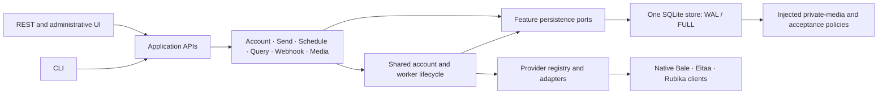

# GoOmni architecture

GoOmni is a modular Go service: one binary, one embedded administrative UI and
one SQLite owner. The consuming application owns its users, permissions and
channel mappings. Native messenger clients do not depend on the consuming
application, HTTP handlers, SQL or webhook dispatch.



## Application and persistence boundaries

`src/usecase` owns the application APIs and persistence ports. Feature services
coordinate their own operations through narrow interfaces; the `Service` facade
composes them over one runtime. Account clients, immutable scope resolution,
session persistence, locks, shutdown and bounded workers remain shared. Splitting
services does not create additional connection owners or worker queues.

REST uses the `Gateway` application interface. Its separate operational storage
port only exposes readiness, statistics and metrics. File registration and
account-scoped local media reads go through the media application service.

Persistence ports expose complete durable operations, not SQL transactions.
Storage still owns the atomic boundaries for enqueue/upload, schedule occurrence
materialization and event/media/delivery/checkpoint acceptance. A failing write
does not become successful acceptance. Uncertain sends remain `unknown` until
reviewed evidence resolves them; the refactor adds no automatic resend.

## Provider adapters

All public adapter contracts live in `src/infrastructure/providers/{provider}`.
They declare discovery metadata, public operation routes, limits and admission
rules. The provider registry is explicitly assembled by the command layer;
there is no implicit default Bale factory. Bale, Eitaa and Rubika occupy the same
architectural role: all three native clients are compiled into the binary and
use the shared application services, SQLite store and durable work lifecycle.

Enablement is runtime configuration, separate from this architecture. Bale is
enabled by default; Eitaa and Rubika are opt-in through `EITAA_ENABLED=true` and
`RUBIKA_ENABLED=true` respectively. Each provider retains its own protocol,
capabilities and verification evidence.

The native packages in `src/internal/{balemeow,eitaameow,rubikameow}` own transport,
authentication, RPC, protocol validation and updates. Public naming conversions,
such as Bale's `push_name` argument, belong to the adapter. Bale's reviewed
operation schema is local to its native package, rather than the shared domain.
Eitaa and Rubika export bounded semantic validation without declaring HTTP routes.

Storage receives pure private-media and acceptance policies through domain
interfaces. It performs encryption, immutable account binding and transactions
itself. Adapters cannot execute SQL or network requests through these policies.
An absent acceptance policy cannot resolve an unknown send. Bale's reviewed
request echo is currently the only registered acceptance proof; a similar-looking
Eitaa or Rubika message is not substituted for it.

Dependency tests check all implementation files, including new files, against
these layer rules. Protocol packages cannot import REST, SQL or application services.

## Capability availability and evidence

Availability, provider enablement and verification are separate:

- `enabled` is configuration, not a test result.
- A listed operation has an implemented public contract and admission rules.
- `evidence` describes the actual recorded test scope. It appears on providers,
  each ordinary send kind and individual operations. `verification` is a readable
  summary derived from that same record.

| Evidence level | Meaning |
| --- | --- |
| `unavailable` | No registered adapter is available. |
| `offline_only` | No recorded live semantic acceptance; consult the offline scope. |
| `live_response` | A live response or acknowledgement was observed; the effect is not established. |
| `live_scoped` | A recorded controlled trial established the described behavior only. |
| `live_failed` | A recorded controlled attempt failed or was rejected. |

Each record includes its scope, references and remaining limitations; dated live
records identify the observation date. The embedded evidence inventory references
the published [acceptance records](providers/acceptance.md). It does not change
those historical results or claim that they ran on the current binary. Provider
outages, old history, codecs, mentions and other unverified cases retain their
recorded limits. Successful HTTP status alone is never promoted to semantic
verification. The panel displays provider evidence beside availability.

## Local read path and schema 9

The immutable event journal remains authoritative. A small `chat_summaries` table
stores one row per connection/peer: event count and the ID/time of its latest
event. New event acceptance updates this projection in the **same transaction**
as the event, media, webhook and checkpoint. Duplicates do not increment counts
or replace accepted data. Any failure rolls the whole batch back.

The conversation list uses the ordered summary index and joins only the selected
event bodies. It no longer ranks and counts the full retained journal on every
read. Peer reads use `(connection_id, peer_key, event_time DESC, id)`. Equal
timestamps have a stable event-ID tie-breaker. Offset pagination still describes
the data at each request; concurrent new events can shift page boundaries.

These are **event summaries**, not reconstructed final chat transcripts. Edits,
deletes and receipts remain independent events and contribute to the existing
event count. Search remains scoped to stored, reviewed message/caption fields;
it performs no provider history import. Exact substring search can still scan
the selected account's candidate events. No FTS engine, retention deletion or
second database is added.

GoOmni 2.3.0 uses schema 8. GoOmni 2.4.0 uses schema 9
to backfill the summary and replace the peer/time index transactionally. The
backfill may take time and temporary disk space on a large retained journal.
Connection IDs, sessions, operation identities/states, checkpoints and stored
webhook bodies are preserved. Follow the existing cold-snapshot procedure in the
[upgrade guide](upgrade-goomni.md); an older binary requires its matching snapshot.

### Synthetic read benchmark

`BenchmarkListChatsRetainedJournal` compares a page of 50 conversations from
100 synthetic peers while retaining 10,000 or 100,000 events. Setup is outside
the timer. Both measurements used the same fixture on 2026-10-11, Go 1.26.9,
darwin/arm64, Apple M4 Pro and the default SQLite build. The baseline was revision
`f99f5b861e5cb77e7f4cff51d03b16b8e140fd52`; the second measurement used this change.

| Retained events | Previous journal query | Summary query |
| --- | ---: | ---: |
| 10,000 | 10.43–10.67 ms/read | 0.18–0.22 ms/read |
| 100,000 | 159.88–163.53 ms/read | 0.18–0.20 ms/read |

These local results measure this read only. They do not establish Linux capacity,
write throughput, 300 live accounts or long-duration resource stability. Reproduce
the current benchmark from `src` with:

```sh
go test ./infrastructure/storage -run '^$' \
  -bench '^BenchmarkListChatsRetainedJournal$' -benchmem -count=3
```

## Verification

Regression coverage compares the summary against the original journal query,
checks query plans and stable ordering, verifies account isolation, and tests
batch/migration rollback and preservation of accepted data. Pure-Go, race, crash,
protocol/parser, contract and browser checks remain required. Test completion
and live acceptance are reported separately; changing architecture does not
close a live-provider acceptance gate.

### Refactor verification — 2026-10-11

Before release versioning, the working tree based on
`f99f5b861e5cb77e7f4cff51d03b16b8e140fd52`
passed `make check`, `make race`, all nine `make fuzz` targets, both `make vuln`
variants, `make ui-check` (43 tests), `make ui-e2e` (33 browser scenarios), the
static documentation build and the isolated Docker fresh-storage/restart smoke.
Vulnerability analysis reported no reachable vulnerable symbols in either build.
Separate native protocol fixtures passed with 100 clients per provider on macOS;
these clients contacted local synthetic protocol servers.

A separate frozen Linux arm64 REST/storage/webhook test binary ran for ten minutes
in Docker with 4 CPUs, 8 GiB, no external network, no warm-up and a 1 GiB test-data
cap. It used 100 synthetic connections per provider, 60 events/second, 10 new
sends/second (eight immediate and two scheduled), the 60-second threefold burst,
10 reads/second and one 1 MiB upload every ten seconds. Production worker counts
and 500 ms polling were retained. Slow and failing destinations were included.

| Result | Recorded value |
| --- | ---: |
| Accepted/completed events | 43,196 / 43,196 |
| Accepted/completed sends | 7,202 / 7,202 |
| Accepted reads / uploads | 6,000 / 60 |
| Rejected admissions | 0 |
| Missed generator slots | 3 events; 0 other slots |
| Durable admission p95 / p99 | 5 / 20 ms |
| Healthy webhook p95 / p99 | 500 / 1,000 ms |
| Backlog drain | 1.08 seconds |
| Peak process RSS | 46,354,432 bytes (about 44.2 MiB) |
| Peak test data | 191,442,696 bytes |

The test binary SHA-256 was
`19d5b80906225952184d2b42b7662e7b854ee4ed94ef90236c8138b79a99156f`;
the runner's source fingerprint was
`c1e060cee921e1aa1569d97d565e2f9948cd9dd6f1c1f41861b0deed740538bc`.
The initial attempt with a 2 GiB data budget did not start because Docker lacked
that budget plus its 2 GiB reserve. The separate 1 GiB smoke passed the same
preflight and enforced its cap; no retained data was deleted to fit the run.
The runner kept the manifest, final verdict and logs in ignored `artifacts/`.
This short synthetic Linux VM run is distinct from live accounts, the longer
capacity comparison, one-hour capacity and 24-hour soak, which remain pending.
